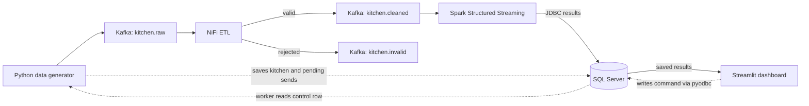
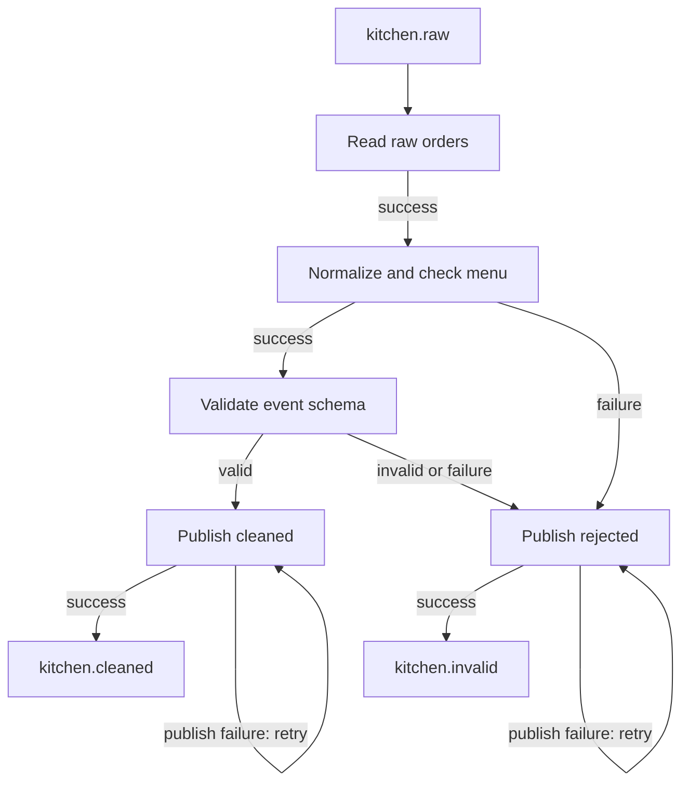
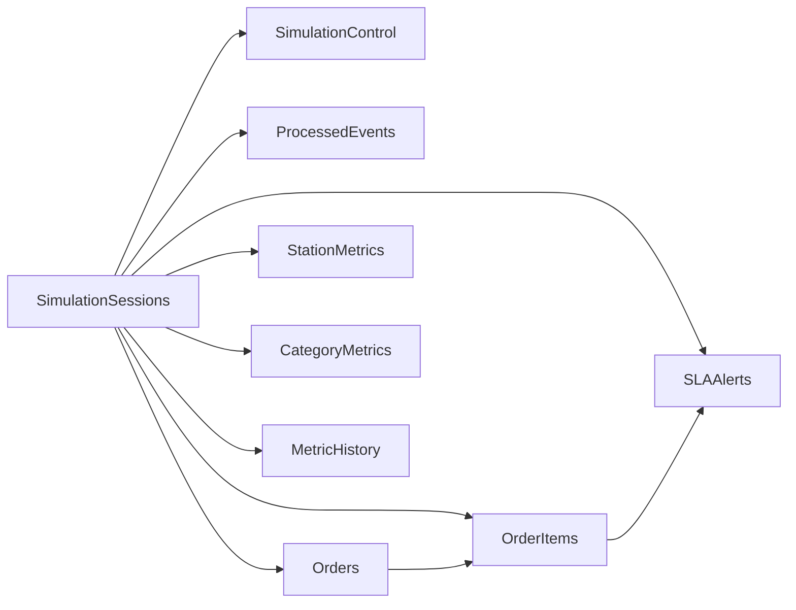
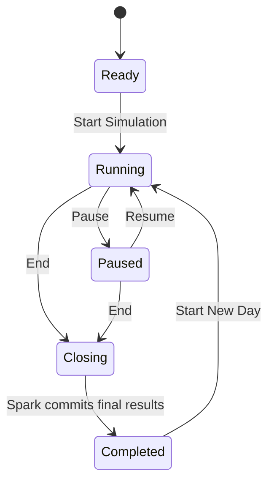

# Real-Time Restaurant Kitchen Order Monitoring
*A study guide for the project discussion*

## 1. Project Introduction

One busy restaurant has five kitchen stations. Each new customer places **one order with one to five items**. A burger and fries belong to the same order, but different stations cook them. A manager needs to know where food is waiting, how long cooking takes, and which dishes are late.

| Word | Meaning in this kitchen |
|---|---|
| Order | The whole customer request. It is ready when every item is ready. |
| Item | One dish or drink with its own ID. Two identical burgers still have two item IDs. |
| Event | A message saying what happened to one item at a given time. |

Every item follows **PLACED → PREPARING → READY**. PLACED puts it in the station's waiting line. PREPARING means it has taken a cooking position. READY frees that position. The **SLA**, or service-level agreement, is the allowed preparation time. Its clock starts when cooking starts.

| Station | Category | Items it can prepare at once | SLA in seconds |
|---|---|---:|---:|
| Grill | Burgers | 6 | 360 |
| Pizza | Pizza | 8 | 480 |
| Fryer | Fried Food | 4 | 240 |
| Salad | Salads | 3 | 180 |
| Drinks | Drinks | 2 | 75 |

The instructor's three measures answer three questions: **How long did finished items take to prepare in each category? How many items are waiting at each station now? Which items have gone over their SLA?**

## 2. Technologies Used

| Technology | Job in this project | Why we use it |
|---|---|---|
| Python 3.11.13 in the app image | Runs the simulator and dashboard | Can schedule kitchen work and send JSON messages. |
| Apache Kafka 4.3.2 | Keeps raw, clean and rejected messages in topics | Each reader can catch up at its own pace. |
| Apache NiFi 2.12.0 | Cleans, checks and routes messages | Students can see each step and its queue. |
| Apache Spark 3.5.5 | Runs the streaming calculations | Can combine events from many items. |
| PySpark | Gives Python access to Spark DataFrames | Expresses counts, averages and time rules in Python. |
| Microsoft SQL Server 2022 CU18 Developer | Stores sessions, event history and results | Keeps business days available after restart. |
| Microsoft JDBC 12.8.1 and ODBC Driver 18 with pyodbc | Connect Spark and the Python apps to SQL Server | Each runtime uses its supported database driver. |
| Streamlit 1.45.1 | Builds the dashboard and its buttons | Presents live tables and accepts commands in the browser. |
| Plotly 6.1.2 | Draws charts inside Streamlit | Lets students inspect station and category values. |
| Docker / Docker Desktop | Runs services in containers | Packages each service with its dependencies. |
| Docker Compose | Starts the related containers and volumes | Gives the services names, startup rules and storage. |
| Kafka UI v0.7.2 | Shows topics, messages and offsets | Lets students inspect the stream between steps. |
| SSMS | Optional Windows tool for SQL Server | Lets students inspect tables, keys and saved results. |

## 3. System Architecture



Follow the **solid arrows** to trace a dish. All three topics live on one Kafka broker. The **dotted arrows** let the browser control the simulator and let the simulator recover its work. A PLACED event still travels through Kafka, NiFi and Spark before it appears as a processed order item.

## 4. Project Startup

1. **Open `Start_Project.bat`.** It opens the project folder and calls `scripts/start.ps1`. PowerShell checks Docker and Compose, attempts to start Docker Desktop if needed, and waits up to three minutes for the engine.
2. **Prepare the images.** The script creates a local SQL password in `.env` on first use and checks the Compose file. An image is the packaged software. A container is a running copy. Docker builds the Python and Spark images with their libraries and drivers, and downloads missing service images.
3. **Start the independent services.** Kafka, NiFi and SQL Server can start in parallel. Once Kafka is healthy, the topic setup creates the three topics if needed, and Kafka UI can start. Once SQL is healthy, the schema setup creates `RestaurantDB`, its tables and its control row if needed.
4. **Connect the services.** NiFi flow setup waits for NiFi and the topics. It enables services, connects processors and starts the flow. Spark and the simulator both wait for the flow and the database schema. The dashboard needs the schema and can start while other services are getting ready.
5. **Check before opening the browser.** Compose waits for health checks. A readiness script checks SQL tables, the simulator heartbeat, Kafka partitions, NiFi processors and services, Spark UI, Kafka UI and Streamlit. The launcher also checks the host web addresses before opening the dashboard.

| Open from Windows | Address |
|---|---|
| Main dashboard | `http://localhost:8501` |
| NiFi canvas | `http://localhost:8081/nifi/` |
| Spark application UI | `http://localhost:4040` |
| Kafka UI | `http://localhost:8085` |
| SSMS database connection | `localhost,1433` |
| Kafka client on the host | `localhost:9092` |

On first startup the control row has no active day. The worker reports that it is alive, but needs a session before it can generate customers. **Start Simulation** opens that day.

## 5. Python Data Generator

The worker loads `config/restaurant.json` when it imports the kitchen module. Pressing **Start Simulation** calls `command()`. It locks the control row, checks the expected state and creates a Running session with a UUID, a noon UTC opening time and an empty kitchen.

| Function | What happens |
|---|---|
| `empty_day()` | Sets up counters, a waiting list per station, a cooking list and the times of the next arrival and clock event. |
| `advance()` | Moves the kitchen forward to each due arrival, completion or clock tick. Other customers can arrive while food cooks. |
| `place_order()` | Chooses one to five items, gives them one shared order ID and separate item IDs, and adds each to its station queue. |
| `serve_stations()` | Finishes due jobs first. Each free position takes the oldest waiting item. This is FIFO, or first in, first out. |
| `event()` | Adds an event ID and simulated UTC time. The session UUID plus counters gives each order, item and event its own ID. |
| `tick()` | Reads SQL controls, advances the saved kitchen and saves new events as pending in the same transaction. |
| `run()` | Polls the kitchen, sends pending events to Kafka and clears the list after Kafka acknowledges them. |

**Arrivals and time.** At the default arrival multiplier of 1, Low Traffic draws an interval of 40–80 simulated seconds, Normal Traffic 20–40, and Rush Hour 10–20. Kitchen Delay also uses 20–40. Each item has a chance of needing a remake while it still holds its cooking position. The chance is 3% in Low Traffic, 6% in Normal Traffic, 10% in Rush Hour and 20% in Kitchen Delay. A remake adds another draw from the same station’s preparation range. Spark raises an alert only when the actual time goes over the SLA. The arrival multiplier changes the gap before the next customer. Speed changes the whole clock: at 10×, one real minute advances ten kitchen minutes.

**Messages.** A pizza and a burger on one order produce two PLACED events, two PREPARING events and two READY events. Either dish may finish first. A separate CLOCK event every five simulated seconds lets Spark see time pass while food cooks. FINAL marks the end of a drained day. Neither control event counts as an item.

Each new day also sends a separate `BROKEN` example with its own ID. NiFi rejects it and saves the reason. It has no item or order and adds zero to the expected valid-event count.

Saving pending events before sending protects against a worker crash. If Kafka receives an event just before the worker stops, the worker may send that same ID again. Section 9 explains how Spark handles it.

## 6. Apache Kafka: Receiving Raw Data

Kafka is a message log. Python adds records at one end. NiFi reads them in order from the raw topic.

| Term | Simple meaning here |
|---|---|
| Cluster, broker | A cluster is a group of Kafka servers. This local cluster has one server, called a broker. |
| Producer, consumer | A producer writes records; a consumer reads them. Python produces raw events and NiFi consumes them. |
| Topic, partition, offset | A topic is a named log. A partition is one ordered part of it. An offset is a record's position in that partition. Each project topic has one partition, which keeps the demo small and easy to follow. |
| Record, key, value, timestamp | A record carries a key, value and Kafka timestamp. The key identifies the item, or the session for a control event. The value contains JSON. Its own `event_time` is the kitchen time used for analytics. |
| Consumer group | Readers in a group share partitions and track progress. NiFi uses `kitchen-etl`. |
| Leader, follower, replication factor | The partition leader handles reads and writes here. Followers can copy its log on other brokers. Factor 1 means one copy on broker 1; this demo has no follower to take over. |
| Retention | Kafka keeps records after a read so another consumer can replay them. The broker sets 168 hours of retention. Eligible closed log segments are removed during cleanup. |

**Sending and waiting.** The worker encodes its key and JSON value as bytes and uses the internal listener `kafka:29092`. Kafka separates producer and consumer in time: Python can send while NiFi is busy. The worker waits synchronously for each Kafka acknowledgment before sending the next message. From `simulator/worker.py`:

```python
key = record.get("item_id", session)
producer.send("kitchen.raw", key=key, value=record).get(timeout=30)
```

**One record example.** The CLOCK at noon in `dataset/part-1.jsonl` has the session UUID as its key. Its complete JSON value is:

```json
{"event_id": "6f3e172f-b405-4d37-b44b-9ad1c38c074d-E3", "session_id": "6f3e172f-b405-4d37-b44b-9ad1c38c074d", "event_type": "CLOCK", "event_time": "2026-01-01T12:00:00+00:00"}
```

**Where does a reader start?** With a usable saved group offset, NiFi continues there. If none is usable, `earliest` starts at the oldest available record, `latest` starts at the end, and `none` reports an error. NiFi is set to `earliest`.

**Who manages the cluster?** Older Kafka setups used the separate ZooKeeper service. This Kafka uses **KRaft** to keep cluster metadata in a controller log. In **combined mode**, node 1 is both broker and controller. Its controller listener is on port 29093. In Kafka UI, open **Kitchen → Topics → kitchen.raw → Messages**. Inspect a key and copy an event ID to find the matching cleaned record later.

## 7. Apache NiFi: ETL Processing

NiFi automates the movement of data. Here **extract** means read from Kafka, **transform** means clean and check the event, and **load** means write to a Kafka output topic. A traditional batch ETL job might process yesterday's file once a day. This flow stays running and handles new messages as they arrive.



| Processor name and type | Input, job and destination |
|---|---|
| **Read raw orders** · ConsumeKafka | Reads `kitchen.raw` through the shared broker service. Group `kitchen-etl`, strategy `FLOW_FILE`, UTF-8 key. Sends one FlowFile per message to normalization. |
| **Normalize and check menu** · ExecuteScript | Groovy reads the raw text. It checks required fields and types, trims spaces, standardizes event type and UTC time, and matches station, item, category and SLA against the menu. It converts item numbers to integers and keeps the IDs. Sends good JSON to validation. On a parsing or menu error, it writes the reason and original text and routes to rejection. |
| **Validate event schema** · ValidateRecord | Reads normalized content with the JSON reader and its schema. Writes a valid record with the JSON writer. Routes valid output to the clean publisher and invalid records or failures to the reject publisher. |
| **Publish cleaned** · PublishKafka | Sends valid content to `kitchen.cleaned` using the `message.key` attribute. Waits for all in-sync replicas to acknowledge. Success ends the FlowFile; failure returns it to this publisher. |
| **Publish rejected** · PublishKafka | Sends failed content to `kitchen.invalid`. Uses the same acknowledgment and retry rules. Can pass a `record.error.message` attribute as a Kafka header when present. |

**Before and after ETL.** These are selected fields from the same captured event in `docs/etl-example.json`. Notice both the spaces and the quotes around the raw number.

| JSON field | Before | After |
|---|---|---|
| `item_name` | `" cola "` | `"Cola"` |
| `station_id` | `" drinks "` | `"DRINKS"` |
| `sla_seconds` | `"75"` | `75` |
| `event_time` | `"2026-01-01T12:03:00+00:00"` | `"2026-01-01T12:03:00Z"` |

**A. Controller Services.** A service supplies a shared tool or setting. A processor calls it to do work. The flow enables three:

- **Kitchen broker** (`Kafka3ConnectionService`) supplies the Kafka address and PLAINTEXT protocol to the consumer and both publishers.
- **Kitchen JSON reader** (`JsonTreeReader`) gives ValidateRecord an explicit Avro schema. Event ID, session ID, event type and time are required strings. Item fields allow null so CLOCK and FINAL can use the same schema.
- **Kitchen JSON writer** (`JsonRecordSetWriter`) lets ValidateRecord write records using the reader's schema. Its output grouping is one JSON object per line.

**B. Attributes and content.** Content is the data being carried. Attributes are small named values attached to it. ExecuteScript changes both. In `nifi/clean.groovy`, `session.write` replaces the content and the following line attaches the output key:

```groovy
flow = session.putAttribute(flow,"message.key",messageKey)
```

ValidateRecord also writes content. A general NiFi flow can use UpdateAttribute just to edit attributes. This project's script already handles that job.

**C. Kafka record and FlowFile.** A Kafka record stays at its partition offset. The FlowFile is NiFi's work item. ConsumeKafka copies the message value into content and exposes metadata such as the Kafka key as attributes. Other processing strategies can put several records in one FlowFile. Our chosen strategy gives the cleaner one message at a time.

**D. Queues and backpressure.** A processor has named exits called *relationships*, such as success and failure. A connection carries an exit's FlowFiles to the next processor and holds a queue between them. Each of the seven connections has thresholds of **1,000 FlowFiles or 10 MB**. Hitting either slows new upstream work until the queue drains. Expiration is a separate rule that discards old queued work after a time limit. Deployment sets no custom expiration; the default of zero means no expiry.

**How the flow runs.** NiFi schedules each processor with a 100 ms period and one concurrent task. Its content repository holds bytes, its FlowFile repository tracks queued work, and provenance records trace its route. The root process group contains the flow. Input and output ports can connect groups in larger designs. This flow connects its processors directly in the root group.

## 8. Apache Kafka: Receiving Cleaned Data

NiFi now acts as a producer. The same broker stores two new streams. **kitchen.cleaned** gives Spark a stable format and a place to resume reading. **kitchen.invalid** keeps rejected data available for inspection without feeding it to the analytics.

A script rejection contains the original text and a reason. A validation failure follows its own failure path; the content and available error attribute depend on where it failed. Both publishers attach the raw offset as a `kafka.offset` header. In Kafka UI, use it to find the input in partition 0 of kitchen.raw. In Data Pipeline Monitor, compare the retained records for one day. After NiFi catches up, each input should have one clean or rejected output. The comparison uses event IDs alone for older outputs that lack the source offset, and a payload fingerprint for messages without an ID. Spark subscribes only to the cleaned topic.

## 9. Apache Spark: Streaming and Analytics

Spark splits data into pieces and performs work on those pieces. Hadoop MapReduce often runs separate jobs with disk output between them. Spark can plan several steps together and keep reused data in memory. This project caches a day's item states while building its reports.

| Spark terms | Meaning in this job |
|---|---|
| Driver, worker, executor, cluster manager | The driver plans work. On a cluster, a manager assigns resources on worker machines and executors run tasks. Here `spark-submit` starts **local[2]**: one local application with two working threads. There is no separate worker cluster or master UI. |
| Spark Core, SparkContext, RDD | Core schedules tasks and handles data partitions. SparkContext is the driver's link to that engine. An RDD is a collection split into partitions. It is immutable: a transformation produces a new result. The project writes its analysis with the higher-level DataFrame API. |
| Structured API, DataFrame, Dataset, Spark SQL | A DataFrame is a table with named, typed columns. Spark SQL plans operations on these tables. Scala and Java also have typed Datasets. This project's PySpark code uses DataFrames and SQL expressions. SparkSession is its entry point. |
| Transformation, action, lazy evaluation, DAG | A transformation such as `where` describes a step. Spark builds a DAG, a graph of steps and their dependencies. An action such as `first()` or `collect()` asks for results and starts the work. |
| Narrow, wide, shuffle | A narrow step can use one input partition at a time, as in filtering item rows. A wide step can need rows from several partitions. Grouping all burgers by category may move rows with the same key together. This move is a shuffle. |
| Jobs, stages, tasks | An action can start a job. A shuffle divides work into stages. A task handles one partition in a stage. The app sets two SQL shuffle partitions. Kafka offsets and Spark execution partitions serve different purposes. |

**The real processing order** in `spark/streaming.py` and `spark/analytics.py`:

1. SparkSession uses UTC. The app checks a JDBC read of the control table, then starts Structured Streaming query `kitchen_orders` on `kitchen.cleaned`. A fresh query starts at the earliest available offsets.
2. A **micro-batch** is one small group of new messages. The trigger interval is **four real seconds**, with at most **500 offsets per trigger**. A slow batch can delay the next one. `foreachBatch` calls `store_batch()` for each batch.
3. `store_batch()` casts binary values to strings, collects this bounded batch, parses the JSON in Python and groups events by session. It inserts unseen IDs and their cleaned payloads into `ProcessedEvents` and **commits the history first**. Spark's JDBC readers use separate connections and need to see those rows.
4. `refresh_day()` reads the affected session's whole event history through JDBC. Its latest event time is the kitchen clock. `parse_events()` applies `from_json` with `EVENT_SCHEMA` to make typed DataFrame columns. A start from an older batch can now meet a READY from this batch.
5. `item_states()` groups by item and its fixed details. It takes the earliest timestamp for each lifecycle step. A ready time gives READY; otherwise a start gives PREPARING; otherwise the item is PLACED. Missing times stay null. Negative durations are left out.
6. `reports()` builds order, item, station, category and alert tables. `count_when()` adds one for each row that meets a condition. A left join with the station list supplies zero counts for quiet stations.
7. `execute()` binds values to JDBC statements. `insert_rows()` writes collected result rows in batches. Spark replaces the affected day's snapshot and saves station samples in one transaction. It then releases the cached item data.

| Mandatory measure | Rule and small example |
|---|---|
| Average prep by category | For READY items with usable times, prep = ready time − start time. Group by session and category and average these seconds. Three burgers taking 360, 480 and 600 seconds average **480 seconds**. Waiting time and unfinished items do not enter this mean. |
| Queue length by station | Count items whose current state is PLACED at that station. Count PREPARING and READY separately. Five items placed, two already cooking, none finished → **three waiting**. |
| SLA alerts | For a cooking item, compare the latest simulated clock minus start time with its SLA. For a ready item use ready time minus start. A 360-second SLA at 480 seconds gives **120 seconds late**. Equality is on time. A CLOCK can expose an Active alert before pickup. READY changes that item's alert to Resolved and keeps its final delay. |

**Recovery.** The persistent checkpoint at `/checkpoints/kitchen-orders` tracks stream progress. Spark resumes from saved offsets after restart. A failed batch can run again. The event ID key prevents duplicate history; rebuilding the snapshot from that history prevents extra items or repeated alerts. The local job rebuilds one affected day at a time, so longer days take more work.

## 10. Microsoft SQL Server

**RestaurantDB** is the shared memory that survives a service restart. Spark reads and writes it through **JDBC** (Java Database Connectivity) and Microsoft's JDBC driver. Python opens SQL connections with **pyodbc** and Microsoft ODBC Driver 18. Operational times are stored as whole seconds since the Unix epoch. The worker heartbeat uses real UTC time.

| Actual table | What one row means | Important columns |
|---|---|---|
| SimulationControl | Shared settings and pointer to the current day | id (always 1), session_id, scenario, speed, arrival_factor, revision, worker_seen |
| SimulationSessions | A business day and its saved kitchen | session_id, status, opened_at, sim_time, closed_at, generated, expected_events, kitchen, pending |
| ProcessedEvents | One unique cleaned event | event_id (primary key), session_id, event_time, payload |
| Orders | One customer order | order_id, session_id, item_count, ready_count, status |
| OrderItems | One dish and its times | item_id, order_id, session_id, station_id, placed_at, started_at, ready_at, wait_seconds, prep_seconds, sla_seconds |
| StationMetrics | Current counts per session and station | session_id, station_id, waiting, preparing, completed, avg_prep, violations |
| CategoryMetrics | Current results per session and category | session_id, category, completed, avg_prep, violations |
| SLAAlerts | One prep alert per late item | item_id (primary key), session_id, status, alert_time, delay_seconds |
| MetricHistory | One station sample at one simulated time | session_id, sample_time, station_id, waiting, preparing |

Arrows below point from a referenced table to a table that holds its key. A new day gets a new session ID, so replacing today's results preserves earlier days.



**Inspect in SSMS.** Open Database Engine at `localhost,1433`. Choose SQL Server Authentication, login `sa`, and use the password in the local `.env`. Select **Trust server certificate** for this local instance. Expand **Databases → RestaurantDB → Tables**. Use **Select Top 1000 Rows** on Orders, OrderItems and SLAAlerts. Match the order and item IDs across the results.

## 11. Streamlit Dashboard

Spark calculates the three required measures. SQL Server stores them. Streamlit reads the selected session through pyodbc and uses Plotly for charts. A Streamlit fragment refreshes every four real seconds. The simulator runs in a separate container, so closing the browser leaves the kitchen running.

| Page | What to look for |
|---|---|
| Overview | Simulation controls, order and item counts, average prep, total, active and resolved SLA violations, the share of orders with a late item, station workload and recent activity. |
| Live Orders | Individual items, lifecycle times and SLA status. Filter by session, order, station, category or status. |
| Kitchen Stations | Waiting and cooking counts, completed items, capacity and percent of positions in use. |
| Analytics | Prep by category, queues, workload, violations and sampled queue trends. A queue value of two means two menu items waiting at that station. |
| SLA Alerts | Active and Resolved rows joined to item details. Filter by alert state and inspect the delay. |
| Simulation Control | Start, pause, resume or end a day. Apply speed and traffic settings or send an isolated invalid demo record. |
| Data Pipeline Monitor | Worker heartbeat, service checks, topic offsets and a raw/clean sample. Inspect the latest rejection and compare inputs with both outputs for the selected business date. An offset is a log position; a replay can add another message for one event. |
| End-of-Day Analysis | Choose a completed session by its opening date, such as November 28, 2026. Review its service window, average wait and prep, SLA percentage, busiest station and observed peak queues. |

## 12. Simulation Controls



| Control | What changes inside |
|---|---|
| Start Simulation | Ready means there is no selected session. Start creates a fresh session, saves an empty kitchen and enables arrivals. |
| Pause / Resume | Pause freezes simulated time, arrivals and kitchen work. Resume continues the same items and queues. The worker keeps reporting liveness while paused. |
| End Simulation | Sets Closing from Running or Paused. Existing items can cook; new customers stop arriving. |
| Start New Day | Creates new counters and a new UUID. The new opening is at noon UTC on a later calendar day than the previous close. |
| Simulation Speed | Apply 1×, 2×, 5× or 10×. The worker multiplies elapsed real time by speed. A change keeps existing simulated due times. |

Each click includes the session and state that the browser last saw. The database lock lets only a matching command change them. A change to state or settings increments a **revision**. When the worker sees a new revision, it skips charging the interval that crossed the change. This keeps paused time out of cooking time.

## 13. Restaurant Closing and End-of-Day Analysis

1. **Closing** means the kitchen is finishing work. The generator stops scheduling arrivals, finishes due jobs and starts waiting items as positions open. It sends the remaining PREPARING and READY events.
2. When all lines and cooking positions are empty, the generator creates FINAL once. It saves the expected count of valid events, including CLOCK and FINAL, and publishes its pending messages.
3. NiFi processes remaining raw messages. Spark consumes the clean events and rebuilds the day's results. An order is READY only when its ready-item count equals its declared order size.
4. Spark changes Closing to **Completed** only when the expected count matches the number of unique persisted events for that session, FINAL exists, and no stored order is still open. It saves the closing time and commits the final results.
5. End-of-Day Analysis can now display the day. Peak queue means the highest **sampled** queue at a saved batch time. Starting another day keeps this report available.

**Stop_Project.bat** runs `docker compose stop`. It stops the containers and keeps their volumes. To get a final report, press **End Simulation** and wait for **Completed** before stopping the project.

## 14. Complete End-to-End Example

Imagine one customer orders a Classic Burger and French Fries during Kitchen Delay. Both stations have room. In this example the burger needs one remake. The times below illustrate the configured rules. Other customers can arrive while this order cooks.

| Kitchen time | Follow this order |
|---|---|
| 12:00:00 | Python creates one order ID and two item IDs. Two PLACED events enter `kitchen.raw`. The payloads carry menu fields such as `"item_name": " classic burger "` and `"item_name": " french fries "`, before NiFi cleans the text. |
| 12:00:00 | Each station takes its item and sends PREPARING. NiFi cleans and validates every event, then publishes to `kitchen.cleaned`. Spark combines the steps by item ID. These two items now add zero to the waiting lines and one to each station's preparing count. |
| 12:02:00 | Fries reach READY. Spark calculates 120 seconds of prep, within the fryer's 240-second SLA. The order stays open because only one of two items is ready. |
| 12:06:05 | A CLOCK shows that the burger has cooked for 365 seconds. Its SLA is 360. Spark can report an Active alert with **5 seconds of delay** when that batch is processed. |
| 12:10:00 | The burger reaches READY after 600 seconds. Its resolved delay is **240 seconds**. Both items are ready, so the order is ready. Each duration contributes to its own category average. Spark saves the updated rows through JDBC; Streamlit shows them on refresh. |
| At closing | End stops arrivals, the rest of the kitchen drains, and Spark checks FINAL and the event count. The completed report includes this order. |

## 15. Final Discussion Summary

| Component or concept | What it does | Why it matters |
|---|---|---|
| Simulator | Creates timed orders and enforces capacity | A queue grows from actual waiting items. |
| Kafka | Holds messages and offsets | Readers can pause or replay. |
| NiFi | Cleans content, sets keys and checks the schema | Spark receives one clean event format. |
| Spark | Rebuilds item state across batches | A heartbeat can reveal a late item before it finishes. |
| SQL Server | Keeps unique events, day results and controls | A restart or new day can keep history. |
| Streamlit | Displays results and submits commands | Students can inspect and control a live day. |

- **Why does one order create six item events?** Two dishes each pass through three steps. The order still represents one customer.
- **What is a Controller Service?** A shared tool a processor calls. ValidateRecord uses both the JSON reader and the JSON writer.
- **Where does the outgoing Kafka key come from?** ExecuteScript sets the FlowFile attribute `message.key`. PublishKafka uses that attribute for the record key. The JSON stays in the content.
- **Where is the wide transformation?** In grouping by keys such as category. Spark may shuffle rows to bring matching keys together.
- **Why keep the event log and the checkpoint?** The log tells Spark what happened to each dish. The checkpoint tells it how far it has read from Kafka.
- **Why can the kitchen be empty while the day is still Closing?** The last events may still be in Kafka, in NiFi queues or in a Spark batch. Completed requires the saved results to catch up.

**What was verified?** The recorded Linux test sent both sample files through Kafka and NiFi. For the updated dataset Spark recovered **162 unique events, eight completed orders, 20 ready items and two resolved violations**. The test report also records a backpressure test and Spark checkpoint recovery. Live acceptance of the SQL-backed sink, full dashboard results and the Windows launcher remains open. See [the project test report](docs/Test_Report.md).
