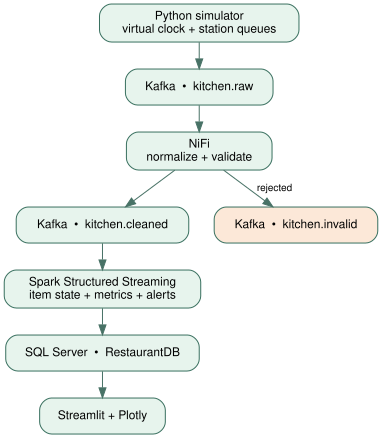
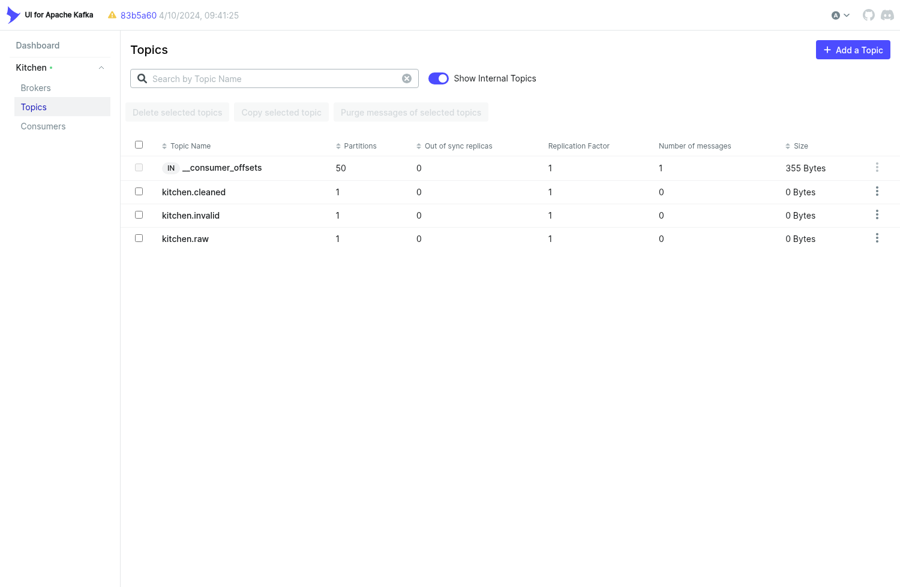
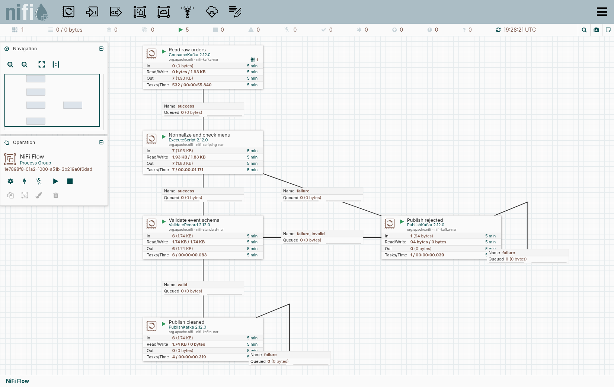
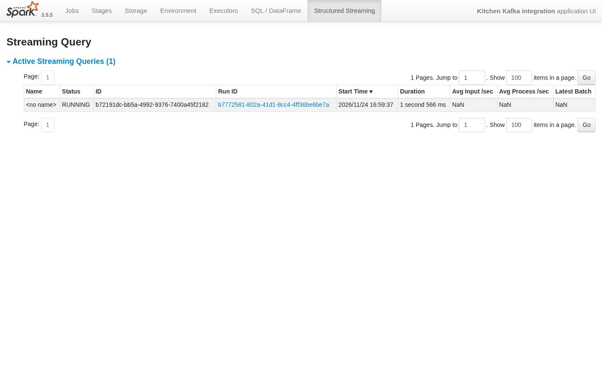
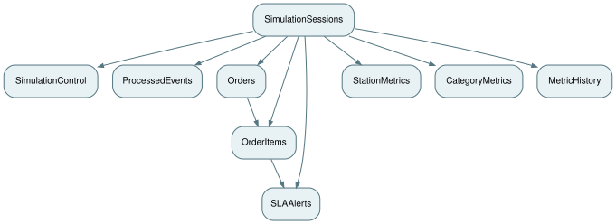

# Reader's guide

This project answers three operational questions for a single high-volume kitchen. How long does each category take to prepare? Which stations have waiting items? Which dishes have exceeded their service-level agreement (SLA) while still cooking? The instructor requires Kafka, NiFi, Spark Streaming and a database. Every business event crosses both Kafka topics and NiFi before Spark writes its results.

## Contents

1. [Restaurant simulation and controls](#member-1)
2. [Kafka transport](#member-2)
3. [NiFi extraction, transformation and validation](#member-3)
4. [Spark streaming and analytics](#member-4)
5. [SQL Server storage](#member-5)
6. [Dashboard, containers and demonstration](#member-6)

Each of the six presenters should trace one order through the whole system and explain replay and session completion. Source listings are expanded directly from the files named above them. To rebuild this PDF from the editable Markdown, install Pandoc, Graphviz, Chromium and Python Playwright on Linux and run `python3 docs/build_handbook.py` in the checkout.



## What one order means

An order represents one customer and contains one to five item IDs. A PLACED event puts one item into a FIFO queue. PREPARING frees its queue position and consumes one preparation position. READY releases the preparation position. An order completes when the number of distinct ready items reaches the declared order size. For example, one burger and one drink yield one order, two items and six lifecycle events.

JSON records share event_id, session_id, event_type and event_time. Item records also carry order_id, order_size, item_id, item_name, station_id, category and sla_seconds. IDs include the session UUID. CLOCK and FINAL carry only the common fields. NiFi's record writer may represent unused item fields as null. One Kafka message holds one JSON object. Each scheduled transition uses virtual UTC time. SQL stores operational timestamps as epoch seconds, and the dashboard converts them to UTC.

SQL carries **commands** in the reverse direction: the browser updates one control row and the simulator polls it. The simulator also persists its queue, clock and unsent messages there. These private recovery records do not supply the dashboard's order counts or Spark's analytics. Inspect processed tables to see what has actually traversed the pipeline.

## Versions and connections

| Component | Runtime and connection |
|---|---|
| Python services | Python 3.11.13, kafka-python 2.2.15, pyodbc 5.2.0, ODBC Driver 18.5.1.1 |
| Kafka | Apache Kafka 4.3.2 (Scala 2.13), KRaft broker/controller, internal port 29092 |
| NiFi | Apache NiFi 2.12.0, ConsumeKafka and PublishKafka with a shared Kafka connection service, JSON record services, Groovy |
| Spark | 3.5.5, Scala 2.12, Java 17, Python supplied by Apache Spark image |
| Spark connectors | Matching Spark Kafka modules 3.5.5, Kafka client 3.4.1, Microsoft JDBC 12.8.1.jre11 for Java 11+ |
| Storage | SQL Server 2022 CU18 Developer, TCP 1433, encrypted client connections trusting local server certificate |
| Presentation | Streamlit 1.45.1, Plotly 6.1.2, pandas 2.2.3, Kafka UI v0.7.2 |

The Kafka clients use the broker's version-negotiated protocol. Spark's Kafka connector must also match the Spark and Scala binary versions. The Python ODBC connection and Spark JVM JDBC connection are independent. Results verified on the cloud machine and the remaining Windows acceptance procedure appear in the test report.

# Member 1 · Restaurant simulation and controls {#member-1}

## Menu, arrivals and time

The config is the single source for station capacity, item spelling, category, preparation range and SLA. The station serving code, NiFi validation and station display all read it. A grill with six positions can begin six burgers together. A seventh waits until a burger finishes. Longer pizza prep is balanced by a larger capacity.

{{source config/restaurant.json}}

A uniform draw between 20 and 40 simulated seconds has a mean of 30, or about 120 new orders per virtual hour. Rush Hour halves that interval. The GUI multiplier divides the next interval, and speed multiplies the elapsed clock time for **all** operations. At 10×, 360 simulated seconds require 36 real seconds. A scenario change affects newly scheduled work. Existing due times remain meaningful.

## Scheduling and recovery

**empty_day(opened)** receives the UTC opening second. It returns counters, one queue per station, a list of cooking jobs and two due times. **event(day, session, kind, now, item)** increments the event sequence, generates an ISO timestamp and adds the item attributes when present. Lowercase and whitespace in item payloads deliberately exercise ETL. CLOCK and FINAL do not carry an item ID.

**place_order(day, session, now, rng)** samples the order size, station and menu independently for each item. The order ID stays the same for its siblings. The function enqueues each item and returns its PLACED event. Supplying a seeded random generator makes a test reproducible.

**serve_stations(day, session, now, scenario, rng)** removes due jobs, emits READY events, then moves waiting items into the available positions. Each new job stores the item and its due time. A delay adds the station SLA to selected drink and grill jobs. Completion and taking the next item may share a timestamp.

**advance(day, session, status, elapsed, speed, scenario, factor, rng)** mutates the saved kitchen and returns messages in simulated time order. Its target is previous virtual time plus elapsed real time times speed. The loop jumps to the next clock, completion or arrival. Closing omits arrival times. When queues and jobs empty, it emits FINAL once and freezes the time. Paused calls return immediately.

{{source simulator/kitchen.py}}

**command(action, expected_session, expected_status, settings)** acquires an update lock on the singleton control row. A stale browser click fails the comparison. Settings validate the speed, mode and arrival factor. Start creates a fresh UUID and noon opening time. A subsequent opening falls on a later calendar day than the previous close. End changes the state to Closing, including from Paused. It returns a Boolean for the UI. Changing state or settings increments a revision so a polling interval spanning a command cannot be charged at the wrong speed.

{{source simulator/control.py}}

**tick(previous, previous_revision)** locks control, updates the worker heartbeat and reads pending messages. A fresh tick uses the monotonic clock; downtime and time spanning a pause/resume boundary do not advance the kitchen. Commands take effect at polling boundaries (about 0.4 seconds plus I/O). It saves the kitchen and its outgoing messages in one SQL transaction. **run()** sends each persisted message to Kafka, waits for acknowledgment, then clears the pending list. A restart after publication but before clearance can duplicate that message. Spark deduplicates it by ID. Run exactly one simulator service for the session.

{{source simulator/worker.py}}

## Discussion

- **Why distinguish order_id and item_id?** A customer's items may go to different stations and finish separately. Order counts use the order ID.
- **What changes at 5×?** Each real second advances five simulated seconds, affecting arrivals, completions and heartbeats together.
- **What happens during pause?** The worker continues reporting liveness but leaves the virtual kitchen untouched. Resuming continues the same queues.
- **Can arrivals happen while a burger cooks?** Yes. The next due arrival competes with all preparation due times in the event loop.
- **What creates a queue at a station?** More items are placed there than its free preparation positions can accept.
- **How does the end button drain a paused kitchen?** Closing permits cooking and queue transitions while removing new arrivals from the schedule.
- **Why store the pending messages?** A crash must retain both a scheduled transition and the event announcing it.
- **What proves a new day is independent?** The new session uses a UUID, fresh counters and a fresh kitchen. Old sessions and their rows retain their keys.

# Member 2 · Kafka transport {#member-2}

Kafka is a durable ordered log. The broker appends bytes to a partition and assigns an offset. Each project topic uses one partition. All station and clock messages use this small log in broker order. Separate Kafka clients can read the same data independently; consumer group progress and topic contents are distinct.

| Topic | Writes | Reads | Key |
|---|---|---|---|
| kitchen.raw | Simulator | NiFi group kitchen-etl | item_id for lifecycle events, session_id for controls |
| kitchen.cleaned | NiFi valid publisher | Spark streaming source | canonical item_id or session_id |
| kitchen.invalid | NiFi rejected publisher | Kafka UI and diagnostic consumers | available message key |

The Kafka section of the Compose listing in Member 6 defines INTERNAL, HOST and CONTROLLER listeners. One node runs the controller and broker; internal topics have replication factor one. The shared cluster ID and broker volume keep log identity stable across restarts. A single node cannot tolerate disk loss. The UI uses the internal broker address.

## Week 9 discussion lab

Kafka decouples fast producers from independent consumers that can pause and replay. A kitchen order log, a clickstream and equipment telemetry all fit that pattern. A Kafka record has a key, a value and a timestamp; the broker assigns its partition offset. Optional headers carry metadata. Here the key identifies an item (or a session for clock events), while the JSON value describes a state transition.

**ZooKeeper and KRaft.** Older Kafka deployments used an external ZooKeeper ensemble to coordinate cluster metadata. In KRaft the Kafka controllers replicate a metadata log using Raft. Their elected leader manages metadata such as partition leadership. In this one-node lab broker and controller share node 1. Inspect its leader ID and voter list with `docker compose exec kafka /opt/kafka/bin/kafka-metadata-quorum.sh --bootstrap-server kafka:29092 describe --status`. The broker JAR is kafka_2.13-4.3.2. The Spark connector uses Scala 2.12 inside the Spark JVM; those Scala versions apply to different processes.

**Replication.** Each partition has a leader. With multiple replicas, followers copy its log and in-sync replicas participate in acknowledgments. Run `docker compose exec kafka /opt/kafka/bin/kafka-topics.sh --bootstrap-server kafka:29092 --describe --topic kitchen.raw`. Leader, Replicas and ISR identify the same broker here. Replication factor one means one copy and no broker failover. A Docker volume preserves records across restart on the same machine.

**Message retention.** The broker sets log retention to 168 hours. With delete cleanup, eligible closed log segments are removed during periodic cleanup. Consuming a message does not delete it. Inspect the effective topic settings with `docker compose exec kafka /opt/kafka/bin/kafka-configs.sh --bootstrap-server kafka:29092 --describe --all --entity-type topics --entity-name kitchen.raw`. Look for cleanup.policy=delete and retention.ms=604800000.

## Creation, production and inspection

The initialization shell iterates over exactly three topic names, requests one partition and skips existing topics. It runs after a successful broker metadata request. Inside the worker's **run** function in Member 1, JSON serialization produces UTF-8 bytes, key serialization encodes the string, and `acks="all"` waits for the in-sync replicas. The send future raises on failure. The consumer in Member 6 reads bounded samples without committing group offsets.

{{source kafka/topics.sh}}

Open Kafka UI on host port 8085, select Kitchen and Topics, then open kitchen.raw and select Messages. Inspect a PLACED message and copy its event_id. Look for the same ID in kitchen.cleaned. Check the key and the numeric type of the SLA. Use Consumers to inspect kitchen-etl. Spark tracks source offsets in its checkpoint and may use temporary consumer group IDs.



From the checkout, `docker compose exec kafka /opt/kafka/bin/kafka-topics.sh --bootstrap-server kafka:29092 --describe` lists partition leaders and replicas. To read raw JSON use `docker compose exec kafka /opt/kafka/bin/kafka-console-consumer.sh --bootstrap-server kafka:29092 --topic kitchen.raw --from-beginning --max-messages 3`. Start a simulation before waiting for messages.

## Discussion

- **Why use Kafka twice?** The first topic stores producer output; the second exposes the validated contract to Spark. Either stage can catch up independently.
- **Why is localhost wrong inside the simulator?** It identifies the simulator container. Docker DNS resolves the broker service name to the Kafka container.
- **What identifies a Kafka position?** Topic, partition and offset together identify a log position. The application event ID identifies the business transition.
- **Why can the offset grow faster than the event count?** Raw traffic includes controls and invalid records, and retries may publish additional copies.
- **What does a group do?** It coordinates consumers of partitions and can retain committed offsets. A diagnostic consumer can inspect without joining the ETL group.
- **Why choose a single partition?** Local demonstration traffic fits one broker and ordering is easier to inspect. Larger systems must design partitioning around their keys.
- **What survives a stop?** Broker records and offsets in the named data volume, subject to Kafka retention. Keep checkpoint recovery within the available Kafka history.
- **What happens on producer timeout?** The current tick remains pending until acknowledgment and clearance. Identical IDs make subsequent delivery safe for counts.

# Member 3 · NiFi ETL {#member-3}

A FlowFile has content bytes and attributes. Connections queue FlowFiles and apply backpressure. Each processor routes a FlowFile along a named relationship. Open the canvas on port 8081 and use Fit in the Navigate panel. Open a processor's configuration to inspect Settings, Scheduling, Properties and Relationships. The root process group's Controller Services tab shows the shared broker connection and two reusable JSON services.



| Processor | Input and properties | Output and route |
|---|---|---|
| Read raw orders | ConsumeKafka, kafka:29092, kitchen.raw, group kitchen-etl, earliest on first use, UTF-8 keys | One message per FlowFile to normalization on success |
| Normalize and check menu | ExecuteScript with Groovy. Reads raw text, checks required fields, canonicalizes menu, time and numeric types | Success to Validate event schema. Failure wraps original content and reason for Publish rejected |
| Validate event schema | ValidateRecord with Kitchen JSON reader, Kitchen JSON writer and reader schema | Valid to Publish cleaned. Invalid or reader/writer failure to Publish rejected |
| Publish cleaned | PublishKafka, kitchen.cleaned, message.key, replicated acknowledgments | Success terminates. Failure loops back for retry |
| Publish rejected | Same publisher settings, kitchen.invalid, optional record error header | Success terminates. Failure loops back for retry |

The record reader applies an Avro record schema to the JSON. Four fields are required strings; lifecycle fields are nullable for CLOCK and FINAL. The script enforces the stricter item rules before the reader runs. The writer emits one JSON object per line. No external cleaning process consumes raw orders.

## Week 10 discussion lab

**Architecture and traditional ETL.** A traditional scheduled batch job extracts a bounded dataset, transforms it, and loads results at intervals. This NiFi flow runs continuously. Its processors exchange FlowFiles through persistent queues. The content repository stores bytes; the FlowFile repository tracks queue state and content references. Provenance records trace processing history. The project uses the root process group; nested groups are optional organizational containers.

**Kafka record versus FlowFile.** A Kafka record lives at an offset in a topic partition. A FlowFile is NiFi's unit of work, with string attributes and a reference to content. ConsumeKafka's FLOW_FILE strategy creates one FlowFile per Kafka message. Other strategies can batch several messages together. Kafka and NiFi have independent metadata and delivery semantics.

**Which processor edits what?** In Normalize and check menu, ExecuteScript calls session.write to replace the content with canonical JSON, and session.putAttribute to set the message.key attribute. For example, a raw drink has a lowercase station and a string SLA; the cleaned JSON carries DRINKS and an integer. PublishKafka reads the attribute through NiFi Expression Language and uses it as the outgoing Kafka record key. An UpdateAttribute processor can change attributes in another design; the deployed flow uses ExecuteScript for both edits.

**What is a Controller Service?** It is a configured capability that processors reference and reuse. It does not move a FlowFile by itself. Kitchen broker (Kafka3ConnectionService) supplies the broker address and protocol to all three Kafka processors. Kitchen JSON reader (JsonTreeReader) parses content using the configured Avro schema. Kitchen JSON writer (JsonRecordSetWriter) serializes validated records for output. Open the root group's Controller Services tab and trace the references back to the processors.

**Back pressure.** Open a connection's configuration and inspect Settings. Each connection has thresholds of 1,000 queued FlowFiles and 10 MB of queued content. Reaching either threshold makes NiFi hold back new upstream scheduling until the downstream processor drains the queue. In-flight work can overshoot a threshold. In an isolated lab run we temporarily set the count threshold to three and stopped the downstream normalizer. Three records filled the queue. While 154 more waited upstream, the queue stayed at three. Restoring the limit and starting normalization delivered all 157 records. Inspect connection queue size and consumer lag separately when explaining the result.

## Normalization walk-through

The wire test sends item_name `" cola "`, category `" drinks "`, station_id `" drinks "`, event_type `"placed"`, SLA `"75"` and an offset timestamp. The output values verified by the test are Cola, Drinks, DRINKS, PLACED and JSON number 75. OffsetDateTime parses the offset and toInstant emits UTC. The IDs are preserved. A separate malformed message produces JSON with its original text and an error reason.

The Groovy callback receives input and output streams for one FlowFile. **field** checks non-empty strings and size limits. **number** checks decimal digits, positivity and range. The menu lookup verifies the station, category, spelling and SLA together. The result object contains only fields intended for the cleaned schema. The message.key attribute follows the FlowFile to the publisher. An invalid demo never shares a valid item's lifecycle ID.

{{source nifi/clean.groovy}}

### One record captured from the running wire test

{{source docs/etl-example.json}}

## Automatic deployment

**api(path, body, method)** submits JSON to the NiFi REST API and returns a decoded entity. It reports HTTP status and response details on errors. **deploy()** discovers the root group, locates existing services and processors by name, creates missing entities, connects named relationships and starts downstream processors before the consumer. Revisions guard concurrent changes. It checks validation and running state. The coordinate pairs set canvas placement; loop bends make publisher retries visible.

{{source nifi/deploy.py}}

The local NiFi launcher configures HTTP on the loopback-published Compose port and sets the JVM heap before starting the service.

{{source nifi/start-local.sh}}

## Discussion

- **Why use both Groovy and ValidateRecord?** Groovy checks the domain rules and transforms the bytes; ValidateRecord applies the structural schema and writes the clean JSON.
- **How does NiFi handle invalid JSON?** The script catches the parse exception and sends the original text with a reason to the invalid publisher.
- **What are attributes used for here?** The key attribute carries routing metadata while the content carries the JSON business record.
- **Why enable controller services first?** ValidateRecord depends on an available reader and writer before NiFi will validate and start it.
- **How is duplication of processors avoided?** Deployment first reads existing names and relationship endpoints. A second invocation discovers the same flow.
- **Where do publishing failures go?** A failure connection returns the FlowFile to the same publisher so queued data can be retried.
- **Why preserve the ID?** Spark must recognize a replay after NiFi or Kafka redelivery.
- **What does a green start icon establish?** A running processor. The wire test separately demonstrates real input, transformed output and rejection behavior.

# Member 4 · Spark Structured Streaming {#member-4}

The production application runs one Structured Streaming query. Its Kafka source subscribes to kitchen.cleaned. Each trigger passes a bounded DataFrame to foreachBatch. Event history in SQL is the state across batches; Spark's checkpoint records stream progress. A micro-batch containing a READY event can therefore use a PREPARING event from an earlier batch.



## Split dataset and narrow versus wide transformations

The primary source continuously generates orders. The repository also includes a reproducible raw dataset from that simulator. With seed 42 and a fixed UTC opening, dataset/generate.py records four simulated minutes of arrivals and drains the kitchen. The first file contains the first two minutes inclusive, the second contains subsequent activity through FINAL. Read part-1.jsonl then part-2.jsonl for event order. These chronological chunks can split an item's lifecycle between files. They contain 48 and 109 unique events respectively, covering eight orders and 17 items. No model is trained and no train/test split is assumed.

In the live Spark job, select/from_json, where and row-wise withColumn are **narrow** transformations. Each output row uses data from its own input partition. groupBy followed by agg for category averages and station counts is **wide** when groups span partitions. Spark shuffles partial results by grouping key before final aggregation. A Kafka partition, a dataset file, and a Spark execution partition have different roles.

For a short classroom demonstration, run `docker compose run --rm --no-deps spark /opt/spark/bin/spark-submit --master local[2] /app/dataset/analyze.py` in the checkout after building the Spark image. Find Filter and Project in the printed physical plan, followed by Exchange (hash partitioning) for the wide aggregation. The two files together yield Burgers 6, Drinks 4, Pizza 3, Fried Food 2 and Salads 2. The live job continues to consume kitchen.cleaned.

{{source dataset/generate.py}}

{{source dataset/analyze.py}}

## Transformations to explain at the board

**parse_events(messages)** casts binary Kafka values to strings and applies an explicit Spark SQL schema with from_json. It returns typed columns. Loading the SQL event log uses the same parser by aliasing the stored payload as value. The simulator's original, uncleaned payload never enters this function.

**item_states(events, clock)** groups lifecycle rows by item and its immutable attributes. For each group it takes the minimum event time matching each transition. READY takes precedence over PREPARING and PLACED even if an older event arrives late. Duration uses ready_at if present, otherwise the latest session clock. The item table exposes elapsed and final times. Missing or reversed timestamps yield null durations, and a waiting item's wait continues until preparation begins.

**count_when(condition)** converts a Boolean predicate to ones and zeros for a Spark sum. **reports(items)** returns the five DataFrames used as current-day results. It counts completed orders against their declared size, counts waiting and preparing separately by station, and uses a conditional average of completed durations by category. Filtering overdue items produces one alert row per item. Alert time is the first whole simulated second strictly over the SLA; observation occurs on a subsequent processed event.

{{source spark/analytics.py}}

Three completed burgers with 360, 480 and 600 seconds have an average of (360+480+600)/3 = 480 seconds. Five placed items and two preparation starts leave three waiting and two preparing. If a start is at 12:02 and a heartbeat reaches 12:10, a 360-second SLA is overdue by 120 seconds. A READY at 12:10 resolves the same item alert with that final delay. Exactly 360 seconds meets the SLA.

## Persisting a micro-batch

**execute(db, sql, rows)** binds every parameter in a prepared JDBC statement, batches the rows and closes the statement. **insert_rows(db, table, columns, rows)** builds a parameterized insert from a known DataFrame's columns. Only application-defined table/column names enter SQL text. **store_batch(messages, batch_id)** groups the cleaned payloads by session, inserts each event ID once, and commits before reading the log on Spark's separate JDBC connections. The batch number identifies a trigger; event IDs remain stable even if checkpoints change.

**refresh_day(db, session)** loads one session's durable event log into Spark. The largest event timestamp, including CLOCK, is the clock for active durations. It caches item states while materializing multiple reports, joins the full station list, replaces the day's result rows in one transaction, and keeps a timestamped queue sample. The final SQL update checks Closing, expected unique count, FINAL and ready orders. If a task fails after the event commit but before completing the reports, a retry recalculates from the same IDs. If it fails after the snapshot commit but before the offset checkpoint, repeated replacement is idempotent.

The main block starts the application, confirms a JDBC read of control state, and attaches the Kafka source to foreachBatch. Up to 500 Kafka records are admitted per trigger. Every four seconds Spark can start the next trigger; a slow batch delays the next one. A liveness file is touched while the query is active after its first recorded progress. The health check verifies the Spark UI and age of that marker.

{{source spark/streaming.py}}

{{source scripts/spark_health.py}}

The driver image downloads the version-matched SQL Kafka connector, token provider, Kafka client, Commons Pool and Microsoft JDBC driver into the distribution's JAR directory. It checks Maven Central's published artifact checksums over TLS. The image creates a writable checkpoint directory for the non-root Spark user.

{{source spark/Dockerfile}}

{{source spark/download_jars.py}}

## Limits and discussion

The single local driver intentionally recomputes one affected business day from history and collects its bounded restaurant workload for JDBC writes. Runtime grows with a long session. Use a single streaming writer. MetricHistory contains queue lengths **observed at successfully persisted trigger times**. A queue that forms and clears between two samples will not appear as a historical peak.

- **What makes this Structured Streaming?** A continuously running readStream Kafka source, a streaming query with triggers and managed offsets, and a foreachBatch sink invoking Spark DataFrame transformations.
- **Why does a heartbeat matter?** Simulated time can pass while all jobs are still cooking. CLOCK advances the elapsed SLA calculation without inventing lifecycle events.
- **Which items enter the category mean?** Completed individual items with a usable preparation start and ready timestamp.
- **Why keep both checkpoint and event log?** One tracks source progress; the other reconstructs business state spanning triggers and supports safe replay.
- **What happens when READY arrives first?** Its timestamp is retained. A later PREPARING fills the missing start and yields the correct final duration.
- **Where does an active alert go after pickup?** The next snapshot stores the same item key as Resolved and retains its final delay.
- **Why use an expected count and a final marker?** Seeing FINAL alone does not prove earlier valid messages have all reached storage.
- **Why are history inserts safe on retry?** Each sample is keyed by session, timestamp and station; a repeated sample time is replaced in the same transaction.

# Member 5 · Microsoft SQL Server {#member-5}

RestaurantDB stores commands, recovery state and Spark outputs in separate tables. SQL Server can enforce relationships and atomic result updates and gives students a familiar SSMS inspection path.



| Table | Row meaning and key |
|---|---|
| SimulationControl | Singleton id=1. Points to the current day, stores user settings, command revision, demo request and worker liveness. |
| SimulationSessions | One UUID per business day. Opening, current and closing virtual timestamps; generated/expected event counts; serialized private kitchen and pending outbox. |
| ProcessedEvents | One accepted event_id. The foreign key, normalized timestamp and cleaned JSON preserve session history. |
| Orders | One order_id. Declared size, ready count, earliest placement and OPEN/READY. |
| OrderItems | One item_id linked to order and session. Menu, category, station, SLA, lifecycle timestamps and durations. |
| StationMetrics | Current waiting, preparing, completed, average completed preparation and violation count, keyed by session and station. |
| CategoryMetrics | Completed items, average completed preparation and violations, keyed by session and category. |
| SLAAlerts | At most one record per item for the preparation SLA. Stores active/resolved state, threshold crossing and delay. |
| MetricHistory | Observed waiting and preparing counts, keyed by session, sample virtual time and station. |

IDs and small labels are varchar. Counts and limits are integers, averages are floats and operational seconds use bigint. datetime2 is used for real UTC worker liveness. nvarchar(max) holds JSON strings of variable size. Missing lifecycle timestamps and empty averages are null. The declarations below specify exact lengths, keys, defaults and checks.

{{source database/database.sql}}

## Connections and initialization

**connect(database, autocommit)** opens pyodbc with the installed Microsoft driver. It reads the password from the environment, braces the ODBC value, and closes the connection on every path. Normal exit commits; closing after an exception rolls back uncommitted work. The initialization script connects to master in autocommit mode so CREATE DATABASE can run. GO is a client-side batch separator, so the script splits the file, executes batches in order on the same connection, and verifies singleton access. Repeated startup preserves the schema, sessions and settings. Schema migrations for future code changes would require a separate migration plan.

{{source database/connection.py}}

{{source database/initialize.py}}

## SSMS lab

1. Open SQL Server Management Studio on the Windows host. Choose **Database Engine**, server **localhost,1433**, and **SQL Server Authentication**.
2. Enter login **sa** and the password from the local project .env file. Keep encryption enabled and select **Trust server certificate** for this local Developer instance.
3. Expand **Databases → RestaurantDB → Tables**. Expand dbo.OrderItems → Columns and Keys. Trace its order_id foreign key to Orders.
4. Open **New Query** and run the queries below before and after a lifecycle transition. Copy a session_id from the first result to filter a specific day.
5. Compare an item's prep_seconds with its start and ready times. Verify the category average in the Spark output table. Observe expected_events becoming available when the last generator message is scheduled.

```sql
USE RestaurantDB;
SELECT session_id,status,sim_time,expected_events,generated FROM SimulationSessions;
SELECT TOP (20) order_id,item_count,ready_count,status FROM Orders ORDER BY placed_at DESC;
SELECT TOP (20) item_id,station_id,status,placed_at,started_at,ready_at,prep_seconds FROM OrderItems;
SELECT session_id,category,completed,avg_prep FROM CategoryMetrics;
SELECT session_id,station_id,waiting,preparing FROM StationMetrics;
SELECT item_id,status,delay_seconds FROM SLAAlerts ORDER BY alert_time DESC;
SELECT session_id,COUNT(*) AS unique_events FROM ProcessedEvents GROUP BY session_id;
```

## Discussion

- **Why is the event key unique?** A retransmission carries the same event_id. Ignoring an existing key prevents one transition from being counted twice.
- **Why two tables for orders and items?** A customer order contains several independently scheduled items. Their keys express a one-to-many relationship.
- **Why keep processed JSON?** Spark can recover all event times when a later batch supplies missing lifecycle data.
- **Why trust the local SQL certificate?** The development container uses its local certificate. Both drivers encrypt their connections using the configured development trust setting.
- **Which clock does worker_seen use?** Real UTC, because health monitoring must continue while the simulated restaurant is paused.
- **What protects a historical day?** Every result carries a session identifier. Snapshot replacement filters one specific session.
- **Which component decides a violation?** Spark computes elapsed seconds and the threshold comparison. SQL stores and serves the result.
- **Why is stopping Docker safe for history?** SQL files reside in the named sql-data volume. Normal stop/start reuses the volume.

# Member 6 · Dashboard, containers and integration {#member-6}

## Navigation and display

The sidebar selects eight workspaces. Overview combines controls, order and item KPIs, workload and recent activity. Live Orders filters item rows by session, order text, station, category and status. Kitchen Stations shows waiting, preparation, completed work and utilization against the configured capacity. Analytics draws category performance, queue/workload, service-hour demand and sampled history. SLA Alerts filters Spark's Active and Resolved rows. Simulation Control submits guarded commands. Data Pipeline Monitor probes services and compares matching Kafka records. End-of-Day Analysis selects completed days and displays the service window, totals, peak queues, busiest station and SLA percentage.

**read(sql, *params)** fetches rows with bound parameters, preserves cursor column names even for an empty result, and returns a pandas DataFrame. **control_state()** reads the singleton and joins the active session, defaulting to Ready. **day_data(session)** loads the six result tables for that day. **with_times(frame)** copies the frame and converts selected epoch-second fields for UTC display.

{{source dashboard/data.py}}

**act** submits the user's command with its expected state and reruns the UI. **controls** chooses the primary action, disables invalid transitions and groups scenario, speed and arrival multiplier in an explicit Apply form. **chart** converts a non-empty result frame into a Plotly chart. **stations** joins capacities and derives utilization and load labels. **metrics** counts distinct order rows separately from item rows and computes display summaries from persisted Spark output. **order_table** applies the text and multi-select filters and styles lifecycle statuses. **analytics** plots aggregated category/station frames, groups orders into simulated hour bins and sorts the history line by time. **alerts** joins Spark alerts to item details. **render** selects the active or historical day and draws the selected workspace. **refresh** refreshes the fragment every four real seconds and reports a database outage. Opening or closing a browser executes none of the simulator's scheduling loop.

{{source dashboard/app.py}}

**fetch** reads JSON from Compose addresses. **samples** assigns a partition, reads its earliest and end offsets, and seeks near the end without committing. **monitor** checks the database and worker heartbeat, counts running NiFi processors, checks the Spark application and samples Kafka. It matches raw and clean business events by event_id. The generated and persisted counts are per session and include control events. Estimated counts derived from offsets would be misleading when retention or replay occurs.

{{source dashboard/monitor.py}}

## Service orchestration and startup

Docker Desktop supplies the Engine. Compose gives each service a DNS name. The daemon starts Kafka and NiFi, runs one-shot topic initialization and flow deployment, starts SQL Developer and runs the schema installer. The worker waits for flow and schema. Spark also requires both. Dashboard access requires the schema. Health checks query the services, and the Windows launcher checks all advertised web endpoints before opening the browser.

The shared Python image provides the simulator, schema installer and dashboard with the same driver and dependencies. The Spark image includes its own JVM connector stack. The default network is private; the published host ports are loopback-only. Named volumes retain Kafka logs, NiFi config/queued work, SQL files and Spark checkpoints. See the compose listing for actual mount paths. Do not run volume deletion commands on a day you want to keep.

{{source docker-compose.yml}}

{{source Dockerfile}}

{{source requirements.txt}}

**Start_Project.bat** changes to its own directory and invokes PowerShell. **Test-Engine** checks Docker readiness; **Check-Exit** turns a nonzero native command result into a specific startup failure. The script opens Docker Desktop if needed, waits up to three minutes, generates a random local SQL password only on first launch, builds the images and allows ten minutes for service health. It runs the functional checks and probes the host endpoints. **Stop_Project.bat** issues a normal Compose stop. For Linux, **configure.py** generates the equivalent private environment file.

{{source Start_Project.bat}}

{{source scripts/start.ps1}}

{{source Stop_Project.bat}}

{{source scripts/configure.py}}

The worker health query requires a recent real-time heartbeat. **readiness.py** checks real table access, partition metadata, NiFi state/validation, Spark application name, Kafka UI cluster status and the Streamlit health response. SQL readiness and the streaming query's first progress are separate Compose checks. A partially started system must pass them all before the launcher prints its summary.

{{source simulator/health.py}}

{{source scripts/readiness.py}}

## Demonstration and tests

Use the README for the exact one-click sequence. Show one item across raw, cleaned, Spark and database records. Activate Rush Hour and compare waiting against preparing; a full station can have zero waiting. Activate Kitchen Delay and compare an active alert before and after pickup. Pause the clock, then end the day while paused. Show that closing accepts no arrivals. Wait for Completed, open its final report, then start a new day and reselect the historical day.

The deterministic simulator suite injects a seeded random generator and inspects actual event sequences, capacities and clock movement. The Spark suite supplies known timestamps and asserts against actual DataFrames. The wire test sends valid, replayed, control and malformed messages through a live broker and NiFi. The streaming probe advances one Kafka offset per micro-batch and restarts the same sink using its checkpoint. The local Parquet sink is isolated to this transport test; production uses SQL Server.

On a machine with the SQL image, run the full-stack acceptance script. It starts a private test project, injects a 75-second SLA item and a heartbeat, verifies the active alert, restarts the Spark service, then delivers duplicates, READY and FINAL. The next test uses the real control API, waits for SQL completion, renders the dashboard pages and starts a second day. A full stack stop/start ends with a query for the original unique IDs. The test report records the execution status of each check.

{{source scripts/test-stack.ps1}}

{{source tests/sql_replay.py}}

{{source tests/full_pipeline.py}}

{{source tests/wire.py}}

{{source tests/stream_probe.py}}

{{source tests/test_simulation.py}}

{{source tests/test_analytics.py}}

## Troubleshooting and discussion

- **Why does Start wait after containers appear?** Broker metadata, NiFi validation, SQL queries and streaming offset discovery can become ready at different times.
- **What does Closing with no dashboard updates suggest?** Inspect the simulator heartbeat, raw and cleaned offsets, NiFi rejection reasons, Spark logs and expected/processed counts. Correct the upstream fault before declaring the day complete.
- **Why can the dashboard be closed?** The separate worker owns the kitchen, while SQL owns the commands and durable state.
- **What happens with two Start clicks?** A database lock and a comparison against the expected session/state allow only one transition.
- **Where do the charts get their values?** From session-filtered SQL result tables populated by Spark. User-only filters, labels and presentation rollups run in Streamlit.
- **Why is the Spark UI on 4040?** This project uses a local-mode application driver. Its jobs and streaming progress appear in the application UI.
- **What should a missing Kafka sample display?** Unavailable or waiting for a matching event, since a bounded sample cannot guarantee overlap.
- **Why might first startup fail in the cloud?** The SQL Server manifest can be reachable while Microsoft's redirected image-layer host is blocked. Review the specific registry-domain error and effective environment network rules.
- **How do we know what was tested?** Consult Test_Report.md. SQL-backed acceptance and Windows host checks require their named prerequisites; success of the wire test only establishes its tested stages.
